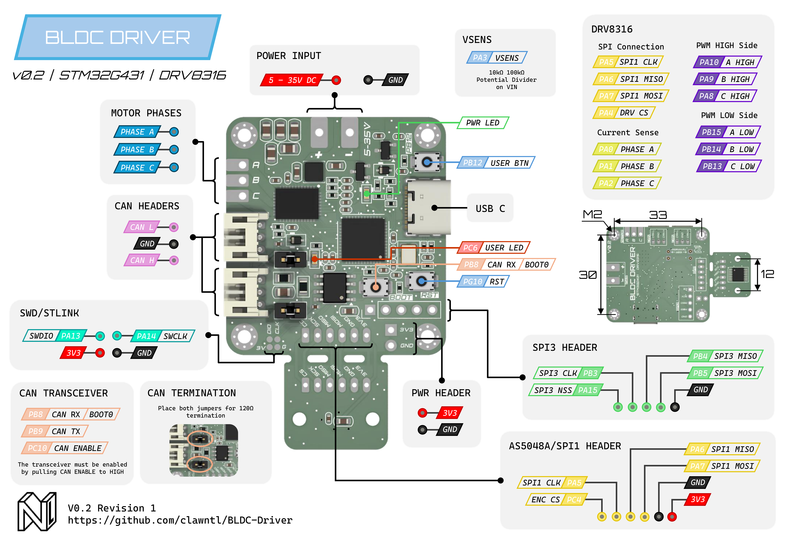

# BLDC-Driver (An FOC Driver Board)

BLDC-Driver is an integrated motor driver based on STM32G431 and DRV8316. An optional AS5048A is integrated and can be broken away if desired making the board compact at just 39mm x 36mm. 

The board is intended to be used in conjuction with [SimpleFOC](https://github.com/simplefoc). DRV8316 supports loads of 3A Continuous (8A Peak) and is ideal for brushless gimbal motors. Low-side current sense is also provided by DRV8316.

CAN Bus is provided by a TJA1051T/3 transceiver supporting FDCAN at up to 5 Mbps. Optional split 120Ω termination is configuring using two pin jumpers. A dedicated SPI bus (SPI3) is also provided as an alternative communication interface.




## Features

Coming Soon


## Documentation

Coming Soon


## Usage/Examples

Coming Soon

```cpp
```


## License

This project is shared under the terms of the [GNU Affero General Public License Version 3](https://choosealicense.com/licenses/agpl-3.0/) as published by the Free Software Foundation.
