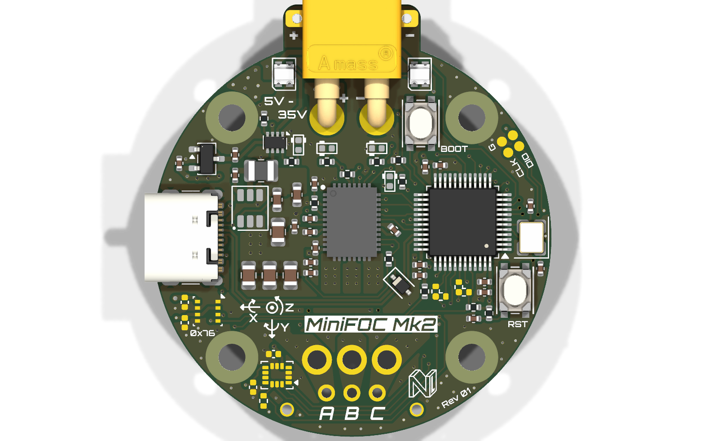
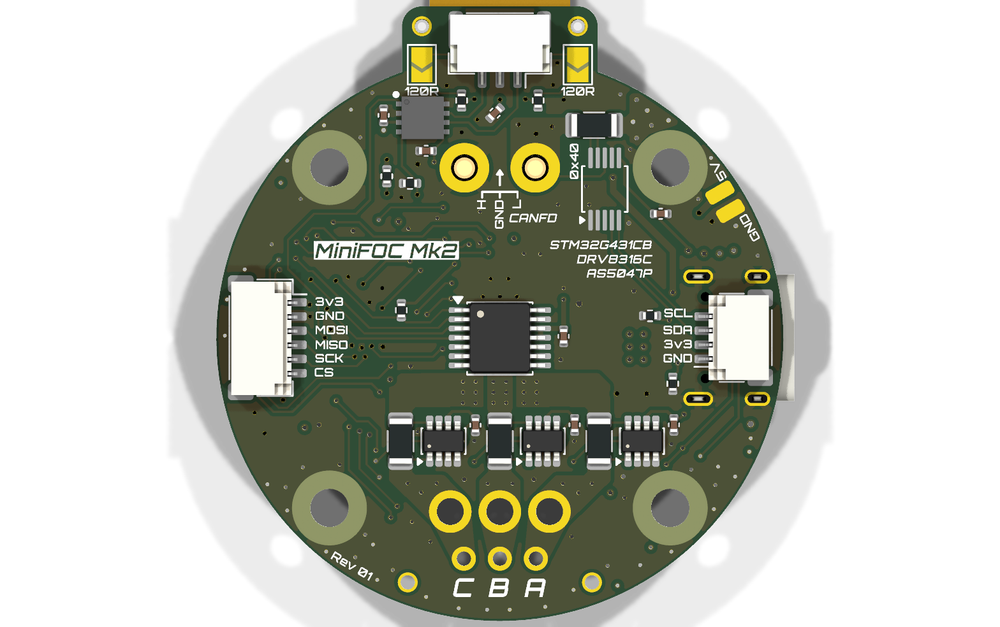

# MiniFOC Mk2: a round, motor-mounted FOC driver

MiniFOC is a compact brushless motor driver built around an **STM32G431** microcontroller and a **TI DRV8316C** three-phase driver with integrated MOSFETs. It's designed to bolt straight onto the back of a gimbal motor or small direct-drive wheel, with the encoder IC sitting over the motor's diametric magnet.

It's the successor to [BLDC-Driver](https://github.com/clawntl/BLDC-Driver). The main changes are a round 40 mm form factor, inline phase-current sensing, an on-board IMU, power monitoring and an XT30 power input. Mk2 isn't perfect, and a Mk3 is planned.

| Top | Bottom |
|---|---|
|  |  |

## Features

| | |
|---|---|
| **MCU** | STM32G431CBT6 (Cortex-M4F, 170 MHz, LQFP-48) with a 16 MHz crystal |
| **Power stage** | DRV8316C with integrated FETs (up to 8 A peak) |
| **Phase current sense** | Inline 3 mΩ shunts on all three phases with INA241A3 amplifiers (50 V/V, bidirectional, about ±10 A range) |
| **Supply** | 5–35 V through an XT30 connector. An AP63205 buck converter makes 5 V and an XC6206 LDO makes 3.3 V. An LM66200 ideal-diode OR lets the board run from USB with no battery attached |
| **Power monitor** | INA226 on a 3 mΩ shunt (bus voltage, current and power over I²C, address `0x40`) |
| **Position sensor** | AS5047P 14-bit magnetic encoder, centred on the bottom of the board |
| **IMU** | LSM6DSV16X 6-axis IMU |
| **Environment** | BME280 temperature/humidity/pressure sensor (I²C, address `0x76`) |
| **Communication** | CAN FD via an ATA6561 transceiver on a JST-GH 3-pin connector, with solder-jumper 120 Ω termination |
| **Other I/O** | USB-C, SWD pads, SPI3 header (JST-SH 6-pin), I²C header (JST-SH 4-pin), BOOT and RST buttons, two WS2812B-2020 RGB LEDs, status LEDs |
| **Board** | 40 mm diameter, 4 layers, 4 × M2.5 mounting holes on a 24 mm square (34 mm PCD) |

## Repository layout

| Path | Contents |
|---|---|
| [`Hardware/`](Hardware) | KiCad project: schematic, PCB, custom symbol/footprint library and 3D models |
| [`Hardware/production/`](Hardware/production) | Fabrication outputs: Gerber zip, BOM and pick-and-place files (JLCPCB/LCSC part numbers) |
| [`schematic.pdf`](schematic.pdf) | PDF export of the schematic |
| [`Images/`](Images) | Board renders |
| `Firmware/` | Not published yet |

## Known issues

This is hardware revision **Rev 01** (Mk2). Known problems will be listed here and fixed in Mk3.

## License

This project is shared under the terms of the [GNU Affero General Public License Version 3](LICENSE) as published by the Free Software Foundation.
