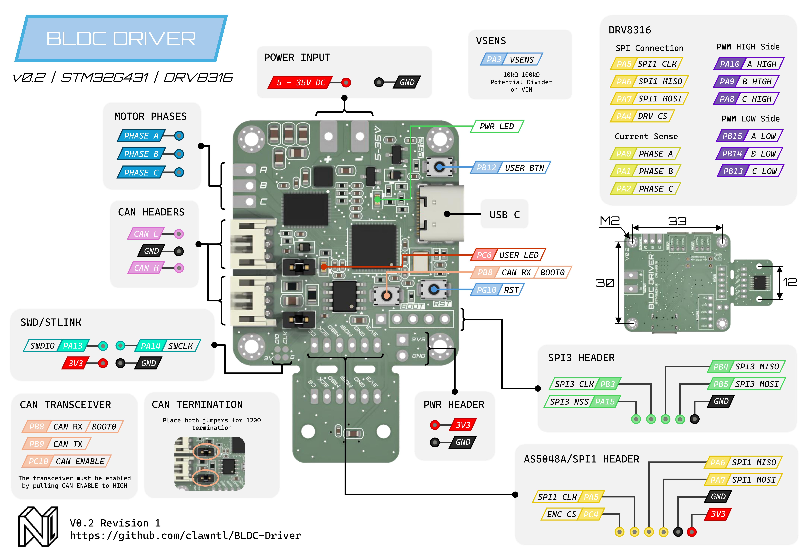

# BLDC-Driver v0.2

BLDC-Driver is a compact brushless motor driver built around an **STM32G431** and a **TI DRV8316** three-phase driver with integrated MOSFETs. It suits gimbal motors and small direct-drive wheels.

An **AS5048A** magnetic encoder sits on a break-away tab. With the tab removed, the board measures **39 mm × 36 mm**.



| | |
|---|---|
| Design files | [`Hardware/bldc_driver_v02/`](../../Hardware/bldc_driver_v02) (KiCad) |
| Schematic | [`schematic_v0.2.pdf`](../../Hardware/bldc_driver_v02/schematic_v0.2.pdf) |
| Firmware environments | `bldc_driver_v02`, `bldc_driver_v02_test` |
| Board config | [`Firmware/boards/bldc_driver_v02/board_config.h`](../../Firmware/boards/bldc_driver_v02/board_config.h) |
| Reported over CAN | Model "BLDC-Driver v0.2", hardware rev 2, capabilities `CAP_MEASURES_SUPPLY_VOLTAGE` |

## Features

| | |
|---|---|
| **MCU** | STM32G431CBU6 (Cortex-M4F, 170 MHz max, run at 160 MHz; CORDIC used for fast trig) |
| **Power stage** | DRV8316 with integrated FETs: 3 A continuous / 8 A peak, 6-PWM control over SPI |
| **Supply** | 5–35 V DC. The DRV8316 buck converter generates 5 V, and an XC6206 LDO generates 3.3 V |
| **Current sense** | DRV8316 integrated low-side current-sense amplifiers on all three phases |
| **Position sensor** | AS5048A 14-bit magnetic encoder (SPI1) on a break-away tab, or an external sensor via the SPI1 header |
| **Communication** | CAN via a TJA1051T/3 transceiver (FDCAN capable up to 5 Mbit/s; the firmware uses 1 Mbit/s classic CAN). Two JST-PH connectors allow daisy-chaining |
| **CAN termination** | Optional split 120 Ω termination, set with two jumpers |
| **Other I/O** | USB-C (CDC serial console + DFU flashing), SWD header, SPI3 header, user button, user LED, power LED |
| **Supply sensing** | 100 kΩ / 10 kΩ divider on VIN, read by the MCU (PA3) |
| **Mounting** | 4 × M2 holes, 33 mm × 30 mm spacing |

## Block overview

```
 VIN 5-35 V ──┬── DRV8316 ── phases A/B/C ──► motor
              │     │  ├─ buck 5 V ──► XC6206 LDO 3.3 V ──► MCU, encoder, CAN
              │     │  └─ CSA outputs SO_A/B/C ──► PA0/PA1/PA2 (ADC)
              │     └─ SPI1 + 6× PWM ◄── STM32G431CBU6 ──► FDCAN1 ──► TJA1051T/3 ──► CAN H/L
              └── 100k/10k divider ──► PA3 (V_SENS)          │
                                       AS5048A (SPI1) ◄───────┤
                                       USB-C (CDC / DFU) ◄────┘
```

## Pin mapping

The source of truth is the board config, [`board_config.h`](../../Firmware/boards/bldc_driver_v02/board_config.h).

### Power stage (DRV8316)

| Signal | MCU pin | Notes |
|---|---|---|
| Phase A high / low | PA10 / PB15 | TIM1 6-PWM |
| Phase B high / low | PA9 / PB14 | |
| Phase C high / low | PA8 / PB13 | |
| Current sense A / B / C | PA0 / PA1 / PA2 | DRV8316 low-side CSA outputs, ADC1 |
| DRV8316 SPI | PA5 SCK, PA6 MISO, PA7 MOSI, PA4 CS | SPI1, shared with the encoder |

### Encoder (AS5048A)

| Signal | MCU pin |
|---|---|
| SPI1 SCK / MISO / MOSI | PA5 / PA6 / PA7 |
| Encoder CS | PC4 |

Both SPI1 devices share MISO. The firmware drives **both** chip selects high before any SPI traffic, so neither device fights the bus. If you attach an external sensor through the SPI1 header, keep this in mind.

### CAN

| Signal | MCU pin | Notes |
|---|---|---|
| CAN RX | PB8 | This pin is also **BOOT0**. The BOOT button pulls it during reset |
| CAN TX | PB9 | |
| CAN enable | PC10 | Must be driven **high** to enable the TJA1051 transceiver |

### Miscellaneous

| Function | MCU pin | Notes |
|---|---|---|
| Supply sense (V_SENS) | PA3 | VIN → 100 kΩ → PA3 → 10 kΩ → GND, so V_PA3 = VIN / 11 |
| User LED | PC6 | Status LED, see [LED patterns](../firmware.md#status-led) |
| User button | PB12 | Active low. The firmware uses it to reboot into DFU |
| Reset | PG10 (NRST) | RST button |
| SWD | PA13 SWDIO, PA14 SWCLK | 2×2 1.27 mm header (3V3, GND, SWDIO, SWCLK) |
| SPI3 header | PB3 SCK, PB4 MISO, PB5 MOSI, PA15 NSS | Spare interface. The firmware doesn't use it |

## Connectors

| Connector | Description |
|---|---|
| Power input | 2-pin, 5–35 V DC and GND |
| Motor phases | A, B, C pads |
| CAN (×2) | JST-PH 2.0 mm 3-pin (CAN L, GND, CAN H), wired in parallel for daisy-chaining |
| USB-C | USB 2.0 full speed: CDC serial console and DFU bootloader |
| SWD | ST-Link programming and debugging |
| AS5048A / SPI1 header | CS, SCK, MISO, MOSI, GND, 3V3. Use it to connect the encoder after breaking off the tab, or to connect another SPI sensor |
| SPI3 header | NSS, SCK, MISO, MOSI, GND |
| Power header | 3V3, GND |

## Jumpers and buttons

- **CAN termination.** Fit **both** jumpers to enable the split 120 Ω termination (2 × 60.4 Ω with a centre-tap capacitor to GND). Enable termination only on the two nodes at the physical ends of the bus.
- **BOOT.** Hold the button while resetting or powering up to start the STM32 ROM USB DFU bootloader.
- **RST.** Resets the MCU.
- **USER (PB12).** In the shipped firmware, a press reboots into DFU.

## Electrical notes

- **Current rating.** The DRV8316 is rated for 8 A peak, but the practical continuous current is about 3 A and depends on cooling. The firmware limits phase current to `MOTOR_CURRENT_LIMIT` (2 A by default).
- **Over-current protection.** The firmware sets the DRV8316 OCP to 16 A with automatic retry after 500 ms.
- **Current-sense gain.** The firmware uses 0.6 V/A. The DRV8316 datasheet's original gain table was wrong: register codes 0–3 actually give 0.15 / 0.3 / 0.6 / 1.2 V/A. As a result, the SimpleFOCDrivers enum `Gain_0V25` really selects **0.6 V/A**.
- **Supply measurement.** VIN is measured at boot for PWM scaling, and then continuously for the CAN heartbeat. The ADC uses a long sample time because the divider has a high source impedance and no filter capacitor. If you run the board from USB only, the reading falls outside the 6–30 V sanity window, and the firmware falls back to `MOTOR_VOLTAGE_POWER_SUPPLY` (12 V). Trim the reading with `VSENS_CALIBRATION` in the board config.
- **Clock.** The board uses a 16 MHz HSE crystal. The MCU runs at 160 MHz, which requires boost mode. USB runs from HSI48 with CRS. See [`clock_config.cpp`](../../Firmware/src/clock_config.cpp).

## Manufacturing

[`Hardware/bldc_driver_v02/production/`](../../Hardware/bldc_driver_v02/production) contains files ready for JLCPCB:

- `v0.2_Custom_Motor_Driver_DRV8316_STM32G4.zip`: Gerbers and drill files
- `bom.csv`: bill of materials with LCSC part numbers
- `positions.csv`: pick-and-place (CPL)
- `designators.csv`, `netlist.ipc`

These files were generated with the KiCad *Fabrication Toolkit* plugin (see `fabrication-toolkit-options.json`). The connectors (power terminal, pin headers) may need to be fitted by hand.
