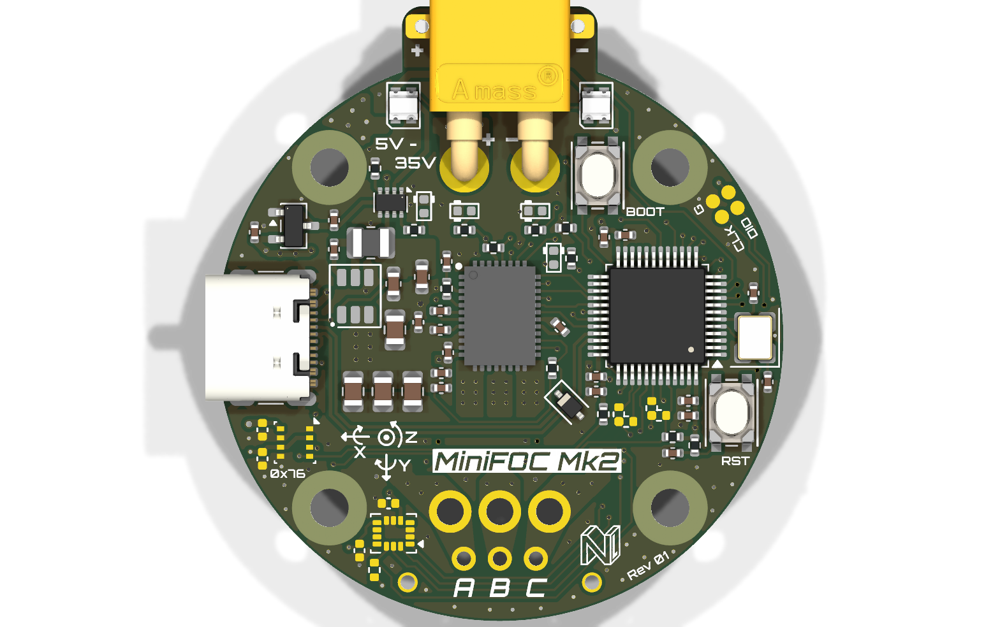
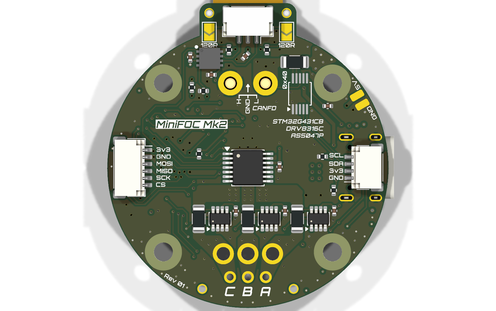

# MiniFOC Mk2

MiniFOC is a round, motor-mounted version of BLDC-Driver: the same **STM32G431** and **TI DRV8316C** core on a 40 mm board that bolts straight onto the back of a gimbal motor or small direct-drive wheel. The encoder IC sits over the motor's diametric magnet. Compared with [BLDC-Driver v0.2](bldc_driver_v02.md), it adds inline phase-current sensing, a power monitor, an XT30 power input and USB power OR-ing, and it has footprints for an IMU and an environment sensor.

| Top | Bottom |
|---|---|
|  |  |

| | |
|---|---|
| Design files | [`Hardware/minifoc_mk2/`](../../Hardware/minifoc_mk2) (KiCad) |
| Schematic | [`schematic.pdf`](../../Hardware/minifoc_mk2/schematic.pdf) |
| Firmware environments | `minifoc_mk2`, `minifoc_mk2_test` |
| Board config | [`Firmware/boards/minifoc_mk2/board_config.h`](../../Firmware/boards/minifoc_mk2/board_config.h) |
| Reported over CAN | Model "MiniFOC Mk2", board ID 2, hardware rev 2, capabilities `CAP_SUPPLY_VOLTAGE`, `CAP_INPUT_CURRENT` |

## Features

| | |
|---|---|
| **MCU** | STM32G431CBT6 (Cortex-M4F, 170 MHz max, run at 160 MHz; LQFP-48) with a 16 MHz crystal |
| **Power stage** | DRV8316C with integrated FETs (up to 8 A peak) |
| **Phase current sense** | Inline 3 mΩ shunts on all three phases with INA241A3 amplifiers (50 V/V, bidirectional, about ±10 A range) |
| **Supply** | 5–35 V through an XT30 connector. An AP63205 buck converter makes 5 V and an XC6206 LDO makes 3.3 V. An LM66200 ideal-diode OR lets the board run from USB with no battery attached |
| **Power monitor** | INA226 on a 3 mΩ shunt (bus voltage, current and power over I²C, address `0x40`) |
| **Position sensor** | AS5047P 14-bit magnetic encoder, centred on the bottom of the board |
| **Optional sensors** | LSM6DSV16X 6-axis IMU (SPI3) and BME280 temperature/humidity/pressure sensor (I²C, `0x76`). Normally not fitted; the firmware doesn't use them yet |
| **Communication** | CAN FD-capable ATA6561 transceiver on a JST-GH 3-pin connector, with solder-jumper 120 Ω termination. The firmware uses 1 Mbit/s classic CAN |
| **Other I/O** | USB-C, SWD pads, SPI3 header (JST-SH 6-pin), I²C header (JST-SH 4-pin), BOOT and RST buttons, two WS2812B-2020 RGB LEDs, status LEDs |
| **Board** | 40 mm diameter, 4 layers, 4 × M2.5 mounting holes on a 24 mm square (34 mm PCD) |

## Pin mapping

The source of truth is the board config, [`board_config.h`](../../Firmware/boards/minifoc_mk2/board_config.h), taken from the KiCad netlist.

### Power stage (DRV8316C)

| Signal | MCU pin | Notes |
|---|---|---|
| Phase A high / low | PA10 / PB15 | TIM1 6-PWM |
| Phase B high / low | PA9 / PB14 | |
| Phase C high / low | PA8 / PB13 | |
| Current sense A / B / C | PA2 / PA1 / PA0 | INA241A3 outputs, centred on 3V3/2. Note the A/C order is reversed compared with BLDC-Driver |
| DRV8316 SPI | PA5 SCK, PA6 MISO, PA7 MOSI, PB0 CS | SPI1, shared with the encoder |

The DRV8316's own current-sense outputs aren't connected.

### Encoder (AS5047P)

| Signal | MCU pin |
|---|---|
| SPI1 SCK / MISO / MOSI | PA5 / PA6 / PA7 |
| Encoder CS | PB1 |

As on BLDC-Driver, the firmware drives both SPI1 chip selects high before any SPI traffic.

### CAN

| Signal | MCU pin | Notes |
|---|---|---|
| CAN RX | PB8 | This pin is also **BOOT0** (10 kΩ pull-down, BOOT button to 3V3) |
| CAN TX | PB9 | |
| CAN transceiver VIO | PC13 | The ATA6561's logic supply is powered from this pin, so it must be driven **high** for CAN to work. STBY is tied to GND |

### I²C, SPI3 and miscellaneous

| Function | MCU pin | Notes |
|---|---|---|
| I²C1 SDA / SCL | PB7 / PA15 | INA226 (`0x40`), optional BME280 (`0x76`), I²C header |
| SPI3 SCK / MISO / MOSI / NSS | PB3 / PB4 / PB5 / PA4 | SPI3 header |
| IMU CS | PB6 | Optional LSM6DSV16X on SPI3 |
| User LED | PB2 | Active high. Status LED, see [LED patterns](../firmware.md#status-led) |
| RGB LEDs | PA3 | WS2812B-2020 data in, two LEDs chained. Not used by the firmware yet |
| SWD | PA13 SWDIO, PA14 SWCLK, NRST | Pads |

## Connectors, buttons and jumpers

| | Description |
|---|---|
| Power input | XT30, 5–35 V DC |
| Motor phases | A, B, C |
| CAN | JST-GH 3-pin |
| USB-C | USB 2.0 full speed: CDC serial console and DFU bootloader. Can power the logic without a battery |
| SPI3 header | JST-SH 6-pin |
| I²C header | JST-SH 4-pin |
| SWD | Pads for ST-Link programming and debugging |

- **CAN termination.** Close the solder jumper to enable the 120 Ω termination. Do this only on the two nodes at the physical ends of the bus.
- **BOOT.** BOOT is wired straight to BOOT0, which is also CAN RX, so the firmware can't read it as a button. To enter the DFU bootloader, hold BOOT and press RST, or type `dfu` in the serial console.
- **RST.** Resets the MCU.

## Firmware notes

The firmware is the same as on every other board; only [`board_config.h`](../../Firmware/boards/minifoc_mk2/board_config.h) differs. What that means on MiniFOC:

- **Current sense:** SimpleFOC `InlineCurrentSense` with the 3 mΩ shunts and 50 V/V INA241A3 amplifiers. Offsets are calibrated with the power stage off; expect about 1.65 V at zero current (`cs` in `motor_test`).
- **Supply:** the INA226 provides the supply voltage, both at boot (PWM scaling) and every 100 ms for the CAN heartbeat. It averages in hardware, so there is no software filter. It also measures input current, which the board reports in the heartbeat (`CAP_INPUT_CURRENT`) and on the `config` console command.
- **DRV8316 buck:** switched off, because 5 V comes from the AP63205.
- **CAN transceiver:** powered from PC13, which the firmware drives high at boot and low just before a software reset, so a reset doesn't land in the DFU bootloader.

Build and flash with `pio run -e minifoc_mk2 -t upload`, then configure the board over USB serial as described in the [firmware guide](../firmware.md#first-time-setup).

## Manufacturing

[`Hardware/minifoc_mk2/production/`](../../Hardware/minifoc_mk2/production) contains files ready for JLCPCB:

- `Driver_Mk2.zip`: Gerbers and drill files
- `bom.csv`: bill of materials with LCSC part numbers
- `positions.csv`: pick-and-place (CPL)
- `designators.csv`, `netlist.ipc`

These files were generated with the KiCad *Fabrication Toolkit* plugin (see `fabrication-toolkit-options.json`). [`bom/`](../../Hardware/minifoc_mk2/bom) has an interactive HTML BOM for hand assembly.

## Known issues

This is hardware revision **Rev 01** (Mk2). No issues have been recorded yet.
